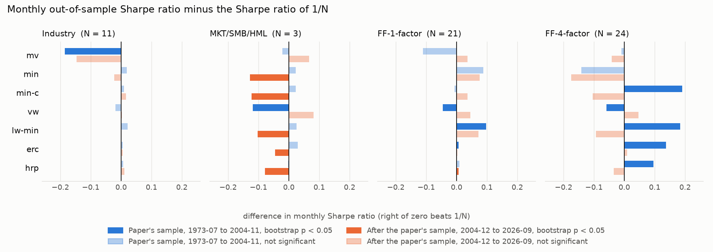
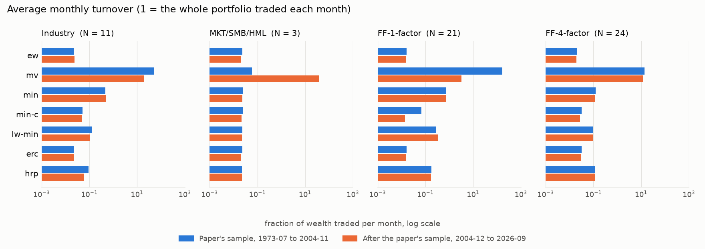

# Occam

[](https://github.com/mal0ware/occam/actions/workflows/ci.yml)

Does any portfolio optimizer beat putting the same amount in everything?

On the Ken French portfolios, no optimizer beats equal weight consistently. From 1973 to 2004, the sample of DeMiguel, Garlappi and Uppal, six optimizing rules on four datasets give 24 comparisons with 1/N. In 6 of them the optimizer has a significantly higher Sharpe ratio and in 1 a significantly lower one. From December 2004 to September 2026, months the paper could not have seen, the count is 1 higher and 5 lower. About 1.2 of 24 would be significant by chance in each period. None of the six has a certainty-equivalent return significantly above 1/N on any dataset in either period.

Those counts use a two-sided 5% test, the Ledoit-Wolf (2008) studentised block bootstrap, which allows fat tails and serial dependence. The test the paper uses assumes independent normal returns and gives 6 and 2 in the paper's sample, then 2 and 8 afterwards.

The paper's 1/N column is reproduced: monthly Sharpe ratios of 0.1353, 0.1613 and 0.1745 against its 0.1353, 0.1623 and 0.1753 on three datasets, and 0.2347 against 0.2240 on the fourth. Its best rule, minimum variance without short sales, had a Sharpe ratio of 0.36 on the FF-4-factor dataset in its sample (0.3649 here, 0.3580 in the paper) and 0.04 afterwards.



Each bar is a rule's monthly out-of-sample Sharpe ratio minus that of 1/N. Solid bars are significant at 5% in the two-sided bootstrap test. The rules are defined below.

The main limit: all four datasets are cut from the same US stocks over the same months, so the 24 comparisons are far from independent. All six wins in the paper's sample are on the two datasets built from size and book-to-market portfolios, and all five losses after 2004 are on one dataset, MKT/SMB/HML. The counts describe these datasets. They are weak evidence about optimizers in general.

## Reproduce

```
uv sync
uv run python scripts/fetch_data.py
uv run python scripts/reproduce.py
```

The last command rebuilds everything in `results/` in about three minutes. Nearly all of that is the bootstrap and two simulations. Seeds are fixed, and a second run gives the same bytes. `--fast` runs two datasets with fewer draws into `results-fast/` for CI.

Every number in this file and in `PAPER.md` is read from a file in `results/`.

## What was run

- The rolling-window test from DeMiguel, Garlappi and Uppal: weights estimated on a 120-month window, held for the next month, and the window moved forward one month at a time. The 60-month window from the paper's appendix is run as well.
- Four of the paper's datasets, all from the Ken French library: ten industries plus the market (N = 11), market, SMB and HML (N = 3), twenty size and book-to-market portfolios plus the market (N = 21), and the same twenty plus four factors (N = 24).
- Five of the paper's rules: `ew` (1/N), `mv` (sample mean-variance), `min` (minimum variance), `min-c` (minimum variance without short sales), `vw` (the market portfolio).
- Four rules the paper did not run: `lw-min` (minimum variance on the Ledoit-Wolf covariance), `erc` (risk parity, as equal risk contribution), `hrp` (hierarchical risk parity), `bl` (Black-Litterman with a neutral view).
- For each rule: Sharpe ratio before and after 50 basis points of cost, certainty-equivalent return, turnover and return-loss.
- Three tests of each Sharpe ratio against 1/N: the Jobson-Korkie test with Memmel's correction that the paper uses, and the two Ledoit-Wolf (2008) tests, one with a HAC standard error and one with a studentised circular block bootstrap.
- A second run on the months after the paper's sample.

The six rules counted in the headline are `mv`, `min`, `min-c`, `lw-min`, `erc` and `hrp`. The market portfolio is a benchmark and is reported separately.

## Results

Monthly Sharpe ratios with a 120-month window. In parentheses are two two-sided p-values of the difference from `ew`: first the paper's test, then the bootstrap with blocks of six months. Full tables for every measure are in `results/tables_paper.md` and `results/tables_after.md`, and the counts are in `results/summary.md`.

Paper's sample, July 1973 to November 2004 (377 months):

| rule | Industry | MKT/SMB/HML | FF-1-factor | FF-4-factor |
|---|---|---|---|---|
| ew | 0.1353 | 0.2347 | 0.1613 | 0.1745 |
| mv | -0.0494 (0.01, 0.01) | 0.2135 (0.69, 0.71) | 0.0513 (0.11, 0.12) | 0.1650 (0.89, 0.90) |
| min | 0.1537 (0.65, 0.65) | 0.2574 (0.51, 0.56) | 0.2496 (0.06, 0.10) | 0.0326 (0.04, 0.10) |
| min-c | 0.1445 (0.76, 0.78) | 0.2574 (0.51, 0.56) | 0.1554 (0.76, 0.74) | 0.3649 (0.00, 0.00) |
| vw | 0.1163 (0.05, 0.09) | 0.1163 (0.00, 0.01) | 0.1163 (0.04, 0.05) | 0.1163 (0.01, 0.02) |
| lw-min | 0.1565 (0.53, 0.53) | 0.2598 (0.40, 0.46) | 0.2582 (0.01, 0.01) | 0.3585 (0.00, 0.00) |
| erc | 0.1415 (0.14, 0.12) | 0.2642 (0.19, 0.24) | 0.1678 (0.01, 0.03) | 0.3119 (0.00, 0.00) |
| hrp | 0.1425 (0.33, 0.36) | 0.2318 (0.94, 0.94) | 0.1704 (0.05, 0.06) | 0.2710 (0.00, 0.00) |

After the paper's sample, December 2004 to September 2026 (262 months):

| rule | Industry | MKT/SMB/HML | FF-1-factor | FF-4-factor |
|---|---|---|---|---|
| ew | 0.1872 | 0.1089 | 0.1439 | 0.1434 |
| mv | 0.0404 (0.11, 0.10) | 0.1757 (0.43, 0.37) | 0.1802 (0.64, 0.63) | 0.1017 (0.63, 0.56) |
| min | 0.1644 (0.66, 0.65) | -0.0193 (0.00, 0.00) | 0.2194 (0.15, 0.13) | -0.0315 (0.04, 0.07) |
| min-c | 0.2037 (0.63, 0.57) | -0.0134 (0.00, 0.00) | 0.1799 (0.13, 0.24) | 0.0393 (0.05, 0.06) |
| vw | 0.1900 (0.83, 0.85) | 0.1900 (0.04, 0.09) | 0.1900 (0.06, 0.11) | 0.1900 (0.08, 0.13) |
| lw-min | 0.1887 (0.97, 0.98) | 0.0063 (0.00, 0.00) | 0.2162 (0.07, 0.07) | 0.0502 (0.16, 0.12) |
| erc | 0.1933 (0.34, 0.23) | 0.0644 (0.00, 0.00) | 0.1463 (0.04, 0.06) | 0.1533 (0.71, 0.73) |
| hrp | 0.1978 (0.38, 0.33) | 0.0299 (0.00, 0.00) | 0.1509 (0.02, 0.04) | 0.1083 (0.05, 0.07) |

Significant Sharpe differences among the six optimizers, out of 24, two-sided at 5%:

| test | 1973 to 2004: above 1/N | below | 2004 to 2026: above 1/N | below |
|---|---|---|---|---|
| Jobson-Korkie with Memmel's correction | 6 | 2 | 2 | 8 |
| Ledoit-Wolf HAC | 6 | 1 | 2 | 8 |
| Ledoit-Wolf bootstrap, blocks of 1 month | 6 | 1 | 2 | 7 |
| Ledoit-Wolf bootstrap, blocks of 3 | 6 | 1 | 2 | 6 |
| Ledoit-Wolf bootstrap, blocks of 6 | 6 | 1 | 1 | 5 |
| Ledoit-Wolf bootstrap, blocks of 10 | 6 | 1 | 1 | 5 |
| Bootstrap, blocks of 6, with Holm's correction | 3 | 0 | 0 | 5 |

What the tables say:

- The three added risk-based rules look good in the paper's sample. `lw-min` and `erc` have a higher Sharpe ratio than 1/N on all four datasets, significantly on two. After 2004 `lw-min` and `erc` are each significantly behind on one dataset and ahead on none. `hrp` is significantly ahead on one and behind on one.
- The wins in the paper's sample are largest on FF-4-factor, the dataset that mixes stock portfolios with long-short factors. On average `erc` and `hrp` put 59.4% and 60.1% of that portfolio in SMB, HML and UMD in the paper's sample, `min-c` 85.6% and `lw-min` 95.1%. 1/N puts 12.5%. Those three factors earned 0.27%, 0.50% and 0.84% a month from 1973 to 2004 and -0.05%, -0.03% and 0.14% a month afterwards, while the market went from 0.55% to 0.84%. These figures are in `results/factor_weights.md`.
- The market portfolio has a lower Sharpe ratio than 1/N on all four datasets in the paper's sample, significantly on three by the bootstrap and on four by the paper's test. After 2004 it is ahead on all four, with no trading. The bootstrap finds none of those four leads significant and the paper's test finds one.
- The choice of test matters more after 2004. The paper's test finds 10 significant differences there and the bootstrap 6. Under Holm's correction for 24 comparisons, three wins survive in the paper's sample and none afterwards, and the five losses on MKT/SMB/HML survive.
- No optimizer has a certainty-equivalent return significantly above 1/N on any dataset in either period. The market portfolio does once, on MKT/SMB/HML after 2004.
- Black-Litterman with a neutral view is not a new column. With no view the model returns its reference portfolio, here the market, so `bl` equals `vw` to the last digit. The identity is tested.

### After costs

Sample mean-variance trades between 2.5 and 10,093 times as much as 1/N per month. `erc` is the only optimizer whose turnover stays near that of 1/N, between 0.98 and 1.61 times.

Monthly Sharpe ratio after 50 basis points of cost on every trade, paper's sample then the months after it:

| rule | Industry | MKT/SMB/HML | FF-1-factor | FF-4-factor | | Industry | MKT/SMB/HML | FF-1-factor | FF-4-factor |
|---|---|---|---|---|---|---|---|---|---|
| ew | 0.1328 | 0.2283 | 0.1598 | 0.1724 | | 0.1844 | 0.1045 | 0.1425 | 0.1415 |
| mv | -0.0454 | 0.1987 | -0.0702 | -0.1048 | | -0.0753 | 0.0497 | 0.0123 | -0.0867 |
| min | 0.0913 | 0.2504 | 0.1520 | -0.1390 | | 0.0920 | -0.0248 | 0.1306 | -0.2076 |
| min-c | 0.1378 | 0.2504 | 0.1479 | 0.3545 | | 0.1964 | -0.0185 | 0.1783 | 0.0309 |
| vw | 0.1163 | 0.1163 | 0.1163 | 0.1163 | | 0.1900 | 0.1900 | 0.1900 | 0.1900 |
| lw-min | 0.1396 | 0.2528 | 0.2193 | 0.2908 | | 0.1728 | 0.0010 | 0.1738 | -0.0244 |
| erc | 0.1388 | 0.2571 | 0.1663 | 0.3051 | | 0.1905 | 0.0598 | 0.1449 | 0.1476 |
| hrp | 0.1314 | 0.2252 | 0.1530 | 0.2457 | | 0.1899 | 0.0246 | 0.1349 | 0.0890 |

After costs an optimizer has a higher Sharpe ratio than 1/N in 13 of 24 cells in the paper's sample and in 7 of 24 afterwards. `mv` is below 1/N in all eight cells. These net figures are not tested for significance.



### The 60-month window

With 60 months of estimation instead of 120, the bootstrap finds 6 optimizers significantly above 1/N and 3 below in the paper's sample (July 1968 to November 2004), and 1 above and 5 below after 2004. The paper's test gives 7 and 4, then 1 and 5. The pattern is the same as with 120 months. The shorter window hurts `mv` most: it is significantly below 1/N on two datasets in the paper's sample, against one with 120 months. `erc` has a certainty-equivalent return significantly above 1/N on FF-1-factor in the paper's sample, the only such cell for an optimizer in any of the four runs. Tables are in `results/tables_paper_m60.md` and `results/tables_after_m60.md`. The paper's own 60-month figures are in an appendix that was not available, so there is no comparison.

## How far to trust "significant"

The paper's test assumes monthly returns are independent and normal. `results/test_size.md` checks all three tests on simulated pairs of series whose true Sharpe ratios are equal, 377 months long, 500 pairs for each process. A sound test at 5% should reject about 5% of the time, give or take 1% with 500 pairs.

| process | Jobson-Korkie with Memmel | Ledoit-Wolf HAC | Ledoit-Wolf bootstrap |
|---|---|---|---|
| independent normal | 0.042 | 0.048 | 0.026 |
| independent t(5) | 0.048 | 0.052 | 0.038 |
| GARCH(1,1), normal shocks | 0.060 | 0.062 | 0.058 |
| GARCH(1,1), t(5) shocks | 0.078 | 0.080 | 0.060 |
| AR(1) 0.2 with GARCH(1,1), t(5) shocks | 0.142 | 0.074 | 0.060 |

With serial correlation of 0.2 the paper's test rejects a true null 14% of the time. The bootstrap stays near 6% and is conservative when returns are independent and normal. That is why the bootstrap count is the headline. Six months was the block length chosen when the test was added. The counts for one, three and ten months are shown above so the choice can be checked.

The first version of this project reported p-values that were one-sided in the direction of the observed difference, so its "significant at 5%" was a 10% two-sided test. Its counts were 8 above and 2 below in the paper's sample and 3 above and 8 below afterwards. All p-values are now two-sided.

## Comparison with the paper

Full detail, with every formula and its equation number, is in `PAPER.md`. All 116 published cells that this project can compute are side by side in `results/paper_comparison.csv`.

- Matches: the 1/N column on three datasets (Sharpe ratio within 0.001), `min-c` on all four (within 0.009), and the paper's significant results for `min` and `min-c`. The paper's p-values agree with half of the two-sided values here, which is what a one-sided reading of its tables predicts.
- 1/N on MKT/SMB/HML is 0.2347 against the paper's 0.2240, and the market's Sharpe ratio is 0.1163 against 0.1138.
- Sample mean-variance does not match out of sample except on MKT/SMB/HML. On Industry its Sharpe ratio is -0.05 here and 0.07 in the paper, and its turnover is 2,344 times that of 1/N here and 606,594 times in the paper.
- The in-sample mean-variance Sharpe ratio is lower than the paper's on every dataset, by 0.009 to 0.059.
- The paper's return-loss for the market portfolio on two datasets (0.0037 and 0.0157) does not follow from its own Sharpe ratios. This project gets 0.0008 and 0.0053.

The files used here were built from the 202609 CRSP database and the paper's around 2005. One hypothesis for the gaps is that the library's history has been revised since. No 2005 copy of the files was found, so this was tested indirectly. `results/revision_sensitivity.md` adds independent noise to every monthly return, reruns the test 100 times, and reports the spread of each Sharpe ratio. The noise has a standard deviation of 1, 5 or 20 basis points a month. One basis point is the precision of the files, and the larger sizes are assumptions.

- Out-of-sample `mv` is fragile enough for the hypothesis to hold. With noise of one basis point, 90% of its Sharpe ratios fall between -0.020 and 0.067 on FF-1-factor and between 0.014 and 0.177 on FF-4-factor. The paper's 0.0128 and 0.1841 are inside the range of the noisy copies. Its weights divide by a sum that passes near zero in some months, so one month can set the column. On Industry the paper's 0.0679 is just above the largest noisy value, 0.0615 at 20 basis points.
- The other gaps are not explained by noise of this kind. 1/N on MKT/SMB/HML moves by about 0.005 at most in 90% of copies at 20 basis points, and the paper's figure is 0.011 away. The in-sample `mv` Sharpe ratio stays outside the noisy range on three of four datasets at every size. `min` on FF-1-factor does too.

So revisions that look like small independent errors can account for the out-of-sample `mv` column on two datasets. They cannot account for the 1/N gap on MKT/SMB/HML or for the in-sample gaps. Those would need revisions that shift average returns, such as a change in how the factors are built, or a difference in method that this project has not found. This analysis was designed after the mismatches were seen.

## Sources

- DeMiguel, Garlappi and Uppal, "Optimal Versus Naive Diversification: How Inefficient is the 1/N Portfolio Strategy?", Review of Financial Studies 22(5), 2009
- Ledoit and Wolf, "Robust performance hypothesis testing with the Sharpe ratio", Journal of Empirical Finance 15(5), 2008
- Ledoit and Wolf, "A well-conditioned estimator for large-dimensional covariance matrices", Journal of Multivariate Analysis 88(2), 2004
- López de Prado, "Building Diversified Portfolios that Outperform Out of Sample", Journal of Portfolio Management 42(4), 2016
- Black and Litterman, "Global Portfolio Optimization", Financial Analysts Journal 48(5), 1992
- Maillard, Roncalli and Teiletche, "On the properties of equally-weighted risk contributions portfolios", working paper, May 2009

Two of the four added rules were published after the paper, `erc` and `hrp`. Ledoit-Wolf shrinkage is from 2004 and Black-Litterman from 1992.

## Data

The Kenneth R. French Data Library. Free, no key. Copyright Fama and French; fetched by script, not committed. `results/data_vintage.json` records the SHA-256 of each file and the CRSP vintage it names.

## How it is tested

146 tests. Three of them need the downloaded files.

- Each optimizer against a hand-solved two-asset case, and mean-variance against the 635% and -535% example in the paper's footnote 8
- Minimum variance without short sales against its optimality conditions and a brute-force grid
- Risk parity against the two closed forms in its paper; hierarchical risk parity against its paper's three-asset worked example
- Ledoit-Wolf shrinkage against the definition written out with loops
- The paper's two significance tests against the formulas in its footnotes, and simulations that their statistics have unit variance and their two-sided p-values reject 5% of true nulls
- The Ledoit-Wolf Sharpe tests: the gradient against finite differences, the HAC covariance against a double loop, agreement with the paper's test on long independent normal series, a rejection rate near 5% under a true null with normal and with t(5) returns, and a rejection of a large true difference
- Weights sum to one, long-only rules stay long-only, and no rule's weights change when later returns change
- Running the pipeline twice gives byte-identical tables
- The equal-weight column and `min-c` against the paper. The tolerances in these two tests were set after seeing the results, to the size of the gaps reported above, so they guard against regressions and do not measure the quality of the replication.

When `data/` is empty the three tests against the paper are skipped. The test run then prints a notice at the top and the bottom and lists each skipped test. CI downloads the files first. If the download works the tests must run, and if it fails the run carries a warning.

## Layout

```
src/occam/             backtest, rules, estimators, tests of significance, tables, figures
tests/                 maths tests first
scripts/reproduce.py   one command rebuilds every figure and table
scripts/fetch_data.py  downloads public data into data/ (never committed)
results/               committed figures and small tables
PAPER.md               citations, formulas, comparison with the sources
```

## Limits

- Portfolios of stocks, not single stocks. The result may not carry over.
- Four of the paper's seven datasets and five of its fourteen rules. The S&P sector and MSCI country data are not free. The Bayesian rules and the mixtures are not implemented, so nothing here speaks to them.
- All four datasets are cut from the same US stocks over the same months. Twenty-four comparisons are far fewer than 24 independent ones. The expected 1.2 false positives per period assumes independence, and Holm's correction does not need it but is conservative.
- The bootstrap is not exact. In the simulations above it rejects 6% of true nulls under GARCH with fat tails, and the simulated processes are simpler than real returns.
- The Ledoit-Wolf (2008) paper could not be retrieved while this was written. The two tests follow the method as published, with one simplification stated in `PAPER.md`, and are checked by the tests and simulations listed above. They were not checked against the authors' code.
- The certainty-equivalent test is still the paper's, which assumes independent normal returns. No bootstrap version was run.
- The "after" period is 262 months in which SMB and HML averaged slightly below zero. It shows that the 1973 to 2004 winners did not persist over those months. It says nothing about the next 262.
- Costs are a flat 50 basis points on every asset. A long-short factor is charged as if it were one asset, which ignores the trading inside it.
- Black-Litterman is run only with a neutral view, where it reduces to the market portfolio. A version with real views would need a source of views, and none is specified.
- The gaps from the paper on 1/N for MKT/SMB/HML and on in-sample mean-variance are unexplained.
- This is research code. It is not investment advice and it does not trade.

The name is from Occam's razor. Equal weight is the rule with no estimated inputs.

## Licence

MIT. See `LICENSE`.
